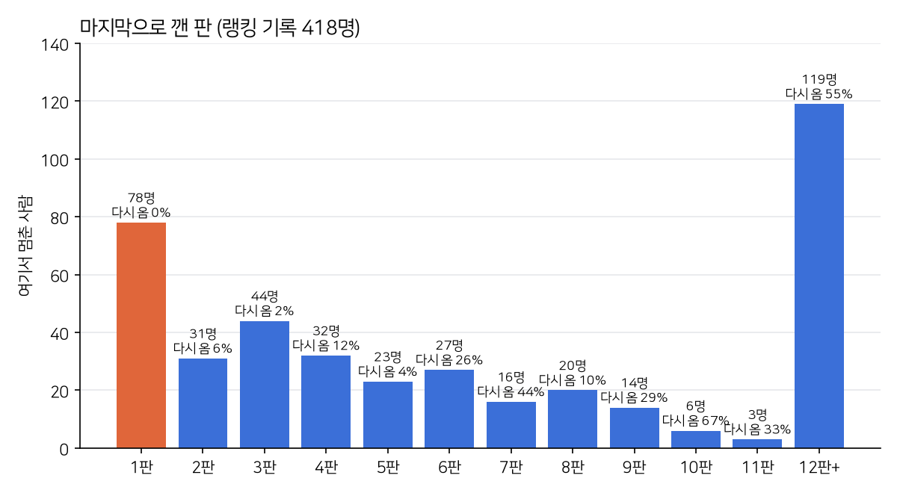

안녕하세요, 이 블로그 주인입니다. [지난 글](/game/enjoy-game/2026/11/01/timoa-리텐션-분석/)에서 띠모아의 D1(다음 날 다시 오는 비율)이 23%이고, 10스테이지까지 가는 사람이 22%라는 것을 봤습니다. 이번에는 **왜** 그런지 찾아봤습니다. 숫자가 가리키는 곳을 게임 코드에서 하나씩 확인했습니다.

### 가장 많이 멈추는 곳: 1판

랭킹 기록에는 플레이어마다 「어디까지 열었는지」가 남습니다. 마지막으로 깬 판별로 사람 수를 세어 보니 막대 하나가 튀었습니다.

- **1판만 깨고 멈춘 사람이 78명(19%)으로 가장 많습니다.** 대부분 별 3개로 깼고, 판은 딱 한 번 했고, **다시 온 사람은 0명**입니다.
- 2~11판 사이에서는 판마다 수십 명씩 꾸준히 빠집니다.
- 반대로 **12판을 넘긴 119명은 55%가 다시 왔습니다.** 이 사람들의 94%는 12판에 나오는 「새 친구 합류」 장면을 봤습니다. 12판 아래로는 그 장면을 본 사람이 없습니다.

정리하면 **첫날 12판 근처까지 가면 다시 오고, 그 전에 멈추면 거의 안 옵니다.** 1판에서 잘 하고도 2판을 누르지 않았다는 건, 어려워서가 아니라 더 할 이유를 못 느꼈다는 뜻으로 읽힙니다. 실패율이 15%뿐이라는 것도 같은 이야기를 합니다.

### 코드에서 찾은 원인

**1. 첫 수까지 너무 멉니다.** 처음 실행하면 이 순서로 화면이 나옵니다.

> 로고 → 인트로 영상 → 이야기 4컷 → 띠 고르기 → 닉네임 입력 → 이야기 → 도움말(3탭) → 타이틀 → 「게임 시작」 → 지도 → 1장 카드 → 1판 → 팁 → 미션 → 「준비! 시작!」

탭 10~12번에 키보드 입력까지 있고, 다 건너뛰어도 35~40초, 읽으면 1분이 넘게 걸립니다. 게다가 도움말을 닫으면 판이 아니라 타이틀로 돌아갑니다. 설치한 사람의 19%가 1판을 시작도 안 한 것과 맞아떨어집니다.

**2. 1~11판이 사실상 같은 판입니다.** 7×7 판에서 동물을 모으거나 특수 블록을 만드는 게 전부입니다. 새로 나오는 건 3판 줄무늬 공과 6판 구름 정도입니다. 장애물(상자·얼음·창살)은 21판, 미니게임은 18판, 친구 합류는 12판에 처음 나옵니다. 만들 때는 「천천히 배우게」 하려던 순서가, 해 보는 사람에게는 「계속 같은 걸 한다」로 느껴진 셈입니다. 장애물이 없으니 1~20판에서는 망치 아이템도 꺼져 있습니다.

**3. 판마다 기다리는 시간이 깁니다.** 판을 시작할 때 미션 카드와 「준비! 시작!」으로 약 4초, 이긴 뒤 결과창까지 2~4초가 걸립니다. 한 판이 짧은 초반에는 이 시간이 크게 느껴집니다.

**4. 다음 날 다시 열 이유가 없습니다.** 출석 보상, 하루 도전, 하트(목숨), 알림이 하나도 없습니다. 처음 보이는 목표도 「12판까지 깨면 친구가 생긴다」 하나뿐입니다.

광고는 원인이 아니었습니다. 지금은 꺼져 있고, 켜더라도 10판이 지나야 나오게 만들어 두었습니다.

### 고칠 순서

**A. 첫날 10판(가능하면 12판)까지 데려가기**

1. **첫 실행을 15초로 줄이기** — 띠를 고르면 바로 1판으로 들어갑니다. 도움말·타이틀·지도는 첫 실행에서 건너뛰고, 판 안의 손가락 안내만 남깁니다. 닉네임은 랭킹이 처음 보일 때 묻습니다.
2. **새것을 앞으로 당기기** — 1~10판에서는 판마다 처음 보는 것이 하나씩 나오게 합니다. 친구 합류는 12판에서 5판으로, 장애물은 21판에서 4·7·9판으로, 미니게임은 18판에서 8판쯤으로 옮깁니다. 지도에는 「5판: 새 친구」처럼 가까운 목표를 보여 줍니다.
3. **판과 판 사이를 짧게** — 초반에는 결과창과 시작 연출을 1초 안팎으로 줄이고, 「다음 판」 단추를 가장 크게 둡니다.
4. **긴장감 조금** — 7~10판에서 움직임 수를 줄여 실패율을 20~30%까지 올립니다. 1~6판은 지금처럼 쉽게 둡니다.

**B. 내일 다시 열 이유 만들기**

5. **7일 출석 보상** — 첫날 끝에 「내일 받을 선물」을 미리 보여 줍니다.
6. **오늘의 도전 판** — 하루 하나, 랭킹이 붙은 판입니다. 이미 있는 랭킹 시스템을 그대로 씁니다.
7. **다음 날 알림** — 기기 안에서 보내는 알림 하나입니다. 권한은 첫 판을 깬 뒤에 묻습니다.

**C. 제대로 재기**

8. 판 시작·성공·실패 이벤트에는 이미 판 번호가 실려 있는데, GA4에 측정기준으로 등록하지 않아 보고서에서 못 보고 있었습니다. 등록하면 랭킹 기록으로 짐작할 필요 없이 판별 이탈을 바로 볼 수 있습니다.
9. 바꾼 것은 Remote Config 값으로 켜고 끌 수 있게 만들어, 사람들을 반씩 나눠 D1과 10판 도달률을 비교합니다.

목표는 **D1 30% 이상, 10판 도달 40% 이상**입니다. 고친 뒤 같은 방법으로 다시 재서 얼마나 움직였는지 적겠습니다.

만들 때는 「처음엔 쉽고 천천히」가 친절하다고 생각했는데, 숫자로 보니 첫날에 필요한 건 친절함보다 「다음엔 뭐가 나올까」였습니다.

플레이 스토어: https://play.google.com/store/apps/details?id=com.enjoygame.timoa
게임 페이지: https://timoa.enjoygame.app
