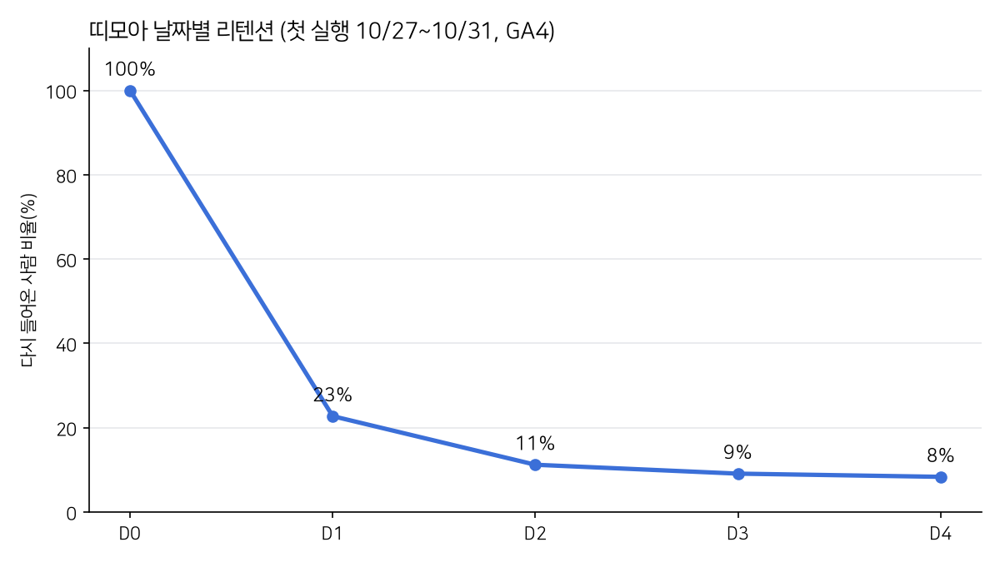
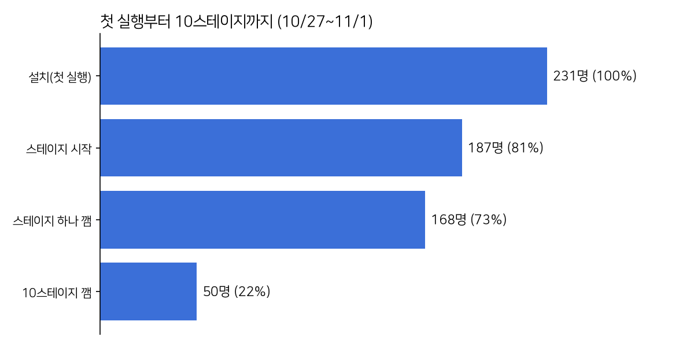
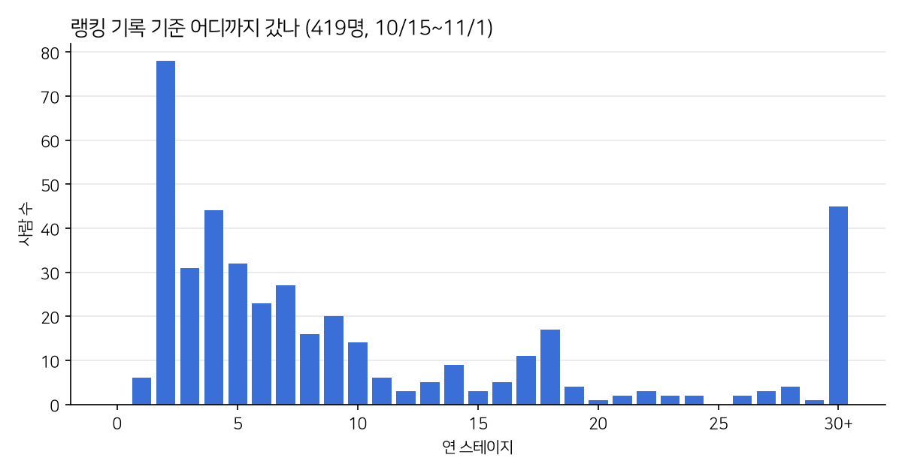
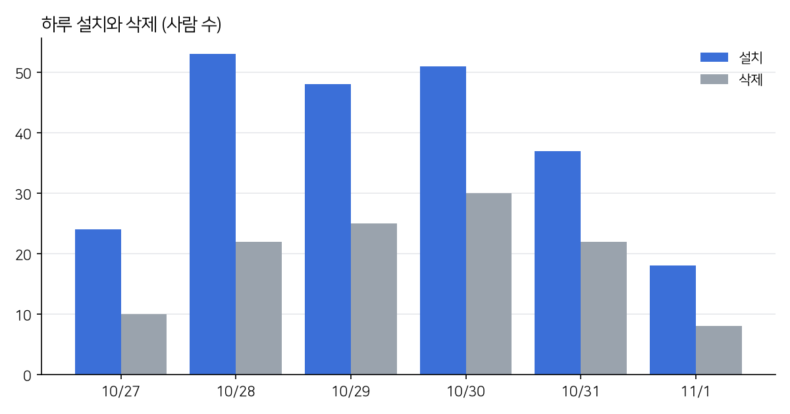

안녕하세요, 이 블로그 주인입니다. 지난 글에서 「띠모아」를 정식 출시한 이야기를 적었습니다. 출시한 지 3주가 지났고, 그사이 구글 광고도 조금 돌려 보았습니다. 이번 글은 들어온 사람들이 **다음 날에도 돌아오는지**, 리텐션을 숫자로 살펴본 기록입니다. 본업이 데이터 쪽이다 보니 제 게임 숫자도 한번 제대로 뜯어보고 싶었습니다.

### 데이터는 두 군데서

1. **GA4(Firebase Analytics)** — 1.0.15부터 넣었습니다. 그래서 10월 27일부터 데이터가 있습니다. 설치(`first_open`), 스테이지 시작 · 성공 · 실패, 앱 삭제(`app_remove`) 같은 이벤트가 쌓입니다. 숫자는 GA4 Data API를 서비스 계정으로 불러 뽑았습니다.
2. **랭킹 기록(Firestore)** — 랭킹에 처음 기록을 올린 때(문서 생성 시각)와 마지막으로 올린 때(수정 시각)가 남습니다. GA4보다 길게, 10월 15일부터 볼 수 있습니다. 대신 「마지막으로 들어온 날」만 알아서, 중간 날짜는 모릅니다.

뽑다 보니 걸러야 할 것이 있었습니다.

- **구글 시험 기기**: 기기 목록 위쪽에 `sdk_gphone`(에뮬레이터)과 OnePlus 8 Pro가 있었습니다. 위치가 애틀랜타 · 레스턴이고 플레이 시간이 0초에 가까워서, 플레이 콘솔의 사전 출시 보고서가 앱을 자동으로 돌려 본 기록으로 보고 뺐습니다. 업데이트를 올릴 때마다 새 사용자가 생깁니다.
- **제 폰**: 개발하면서 지웠다 깔기를 반복한 제 폰 두 대도 뺐습니다. 랭킹에서는 제 닉네임을 뺐습니다.

이렇게 거르고 나니 10월 27일부터 11월 1일까지 실제로 설치한 사람은 **231명**이었습니다.

### 날짜별 리텐션: D1 23%

10월 27일 ~ 31일에 처음 실행한 사람들을 날짜별 코호트로 묶고, 첫날을 D0으로 두었을 때 그 뒤 하루하루 다시 들어온 비율입니다. 아직 끝나지 않은 오늘(11월 1일) 숫자는 넣지 않았습니다.

| | D1 | D2 | D3 | D4 |
|---|---|---|---|---|
| 다시 들어온 사람 | 40 / 176 | 14 / 125 | 7 / 77 | 2 / 24 |
| 비율 | **22.7%** | 11.2% | 9.1% | 8.3% |

D3 · D4는 아직 사람이 적어서 한두 명에 비율이 크게 흔들립니다. 그래도 모양은 분명합니다. **첫날에 대부분이 떠나고, 남은 10% 안팎이 꾸준히 옵니다.**

캐주얼 퍼즐에서 흔히 말하는 D1은 30~40%입니다. 띠모아는 그보다 한참 아래입니다.

랭킹 기록으로 길게 봐도 비슷합니다. 랭킹 기준 플레이어 419명 가운데 **320명(76%)은 첫날과 마지막 날이 같았습니다.** 기록을 처음 올린 뒤 하루 이상 지나서 다시 올린 사람은 27%, 3일 이상은 14%, 7일 이상은 9.5%였습니다. 이 값은 「그날 왔는지」가 아니라 「그 뒤로 한 번이라도 왔는지」라서 GA4의 Dn보다 조금 높게 나옵니다.

### 어디서 떠나나

첫 실행부터 10스테이지까지 따라가 보면 이렇습니다.

- 설치한 231명 가운데 **81%가 스테이지를 시작**했고, **73%가 하나 이상 깼습니다.** 튜토리얼과 첫판에서 막히는 사람은 많지 않았습니다.
- **10스테이지를 깬 사람은 22%** 입니다. 1~10스테이지 사이에서 셋 중 둘이 빠집니다.
- 스테이지 실패(`stage_fail`)를 한 번이라도 겪은 사람은 47명뿐입니다. 시작한 판 3,364번 가운데 실패는 494번(15%)입니다. **어려워서 떠난다기보다, 쉬워서 금방 심심해진다**는 쪽에 가깝습니다.

랭킹 기록으로 본 도달 스테이지도 같은 이야기를 합니다. 가운데값이 6스테이지이고, 2스테이지에 가장 많이(78명) 몰려 있습니다. 첫판 한두 개만 하고 그만둔 사람이 그만큼 많다는 뜻입니다. 반대로 100스테이지를 넘긴 사람도 몇 명 있습니다. 맞는 사람에게는 오래 할 거리가 있다는 점은 다행입니다.

### 삭제가 빠르다

같은 기간 앱을 지운 사람은 **117명**으로, 설치한 사람의 절반쯤 됩니다. 설치가 많았던 10월 28 ~ 30일에는 삭제도 같이 늘었습니다. 설치하고 한두 판 해 보고 바로 지우는 흐름입니다.

1인당 플레이 시간은 6일 동안 평균 약 21분(세션 1.8번)입니다. 처음 온 날보다 다시 온 날에 쓴 시간이 더 깁니다. 돌아온 사람은 제대로 즐긴다는 뜻이니, 문제는 역시 **첫날을 넘기게 하는 것**입니다.

### 광고로 온 사람 vs 그냥 온 사람

설치 231명 가운데 160명이 구글 광고(cpc)로 왔습니다. 들어온 길별 D1은 이렇습니다.

| 들어온 길 | 첫날 | D1 |
|---|---|---|
| 구글 광고 | 160명 | 21% (27 / 129) |
| 플레이 스토어 검색 · 둘러보기 | 35명 | 16% (5 / 32) |
| 직접(링크 · 지인) | 18명 | 53% (8 / 15) |

광고로 온 사람이 특별히 나쁘지는 않았습니다. 스토어에서 스스로 찾아온 사람과 비슷합니다. 지인 쪽이 높은 건 당연하고요. 광고를 더 돌려 사람을 모아도 첫날에 대부분 떠난다면 남는 게 많지 않습니다. **게임 쪽에서 첫날 경험을 고치는 것이 먼저**로 보입니다. 띠모아 광고는 11월 1일에 멈춰 두었습니다.

### 다음에 해 볼 것

1. **초반을 짧고 굵게** — 1~10스테이지가 너무 순하게 흘러가지 않게, 새 블록 · 장애물 · 띠 기술이 더 빨리 나오도록 순서를 당깁니다.
2. **다음 날 돌아올 이유** — 매일 받는 보상, 오늘의 도전 판처럼 「내일 또 열어 볼 이유」를 첫날 끝에 보여 줍니다.
3. **이벤트를 더 촘촘히** — 지금은 스테이지 번호가 GA4 맞춤 측정기준으로 등록되지 않아, 몇 스테이지에서 떠나는지는 랭킹 기록으로 짐작했습니다. 스테이지 번호를 등록해 GA4에서 바로 깔때기를 볼 수 있게 합니다.
4. 고친 뒤 같은 방법으로 다시 재서, D1이 얼마나 움직였는지 다음 글에 적겠습니다.

작은 게임이라 숫자도 작지만, 「내 게임은 재미있다」는 느낌 대신 숫자를 들여다보니 어디를 고칠지가 훨씬 분명해졌습니다.

플레이 스토어: https://play.google.com/store/apps/details?id=com.enjoygame.timoa
게임 페이지: https://timoa.enjoygame.app
