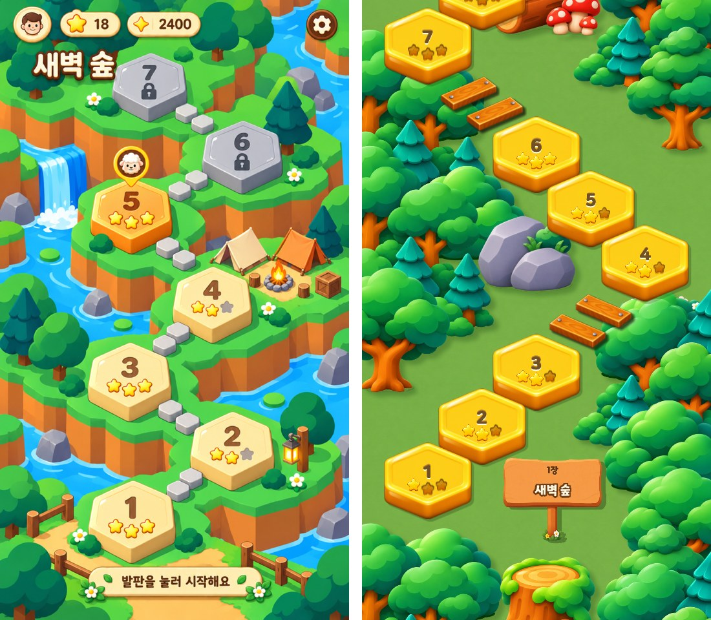
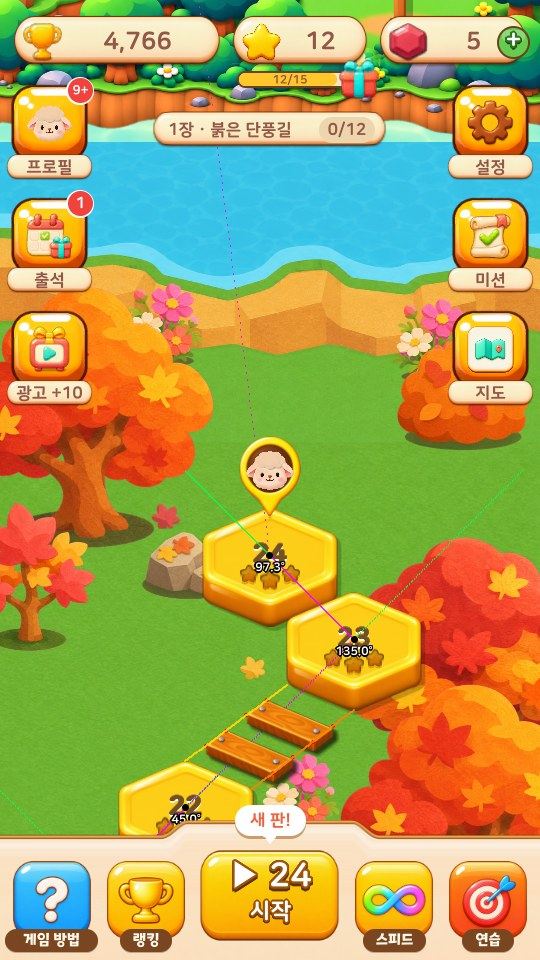
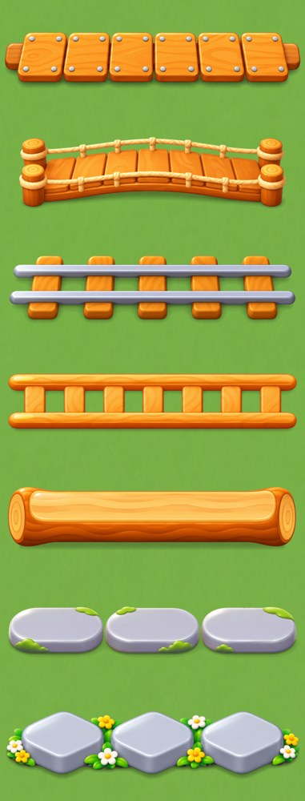
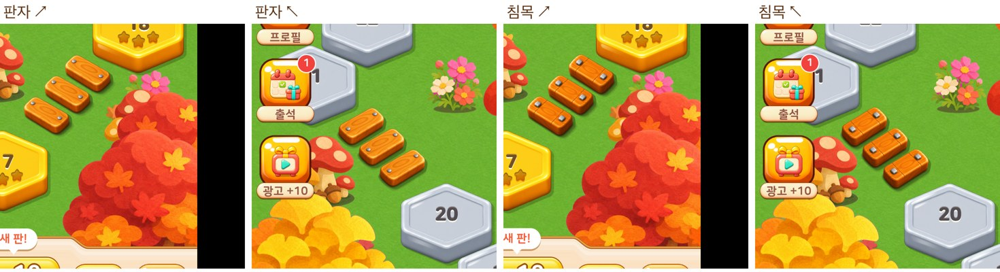
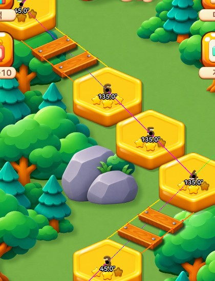
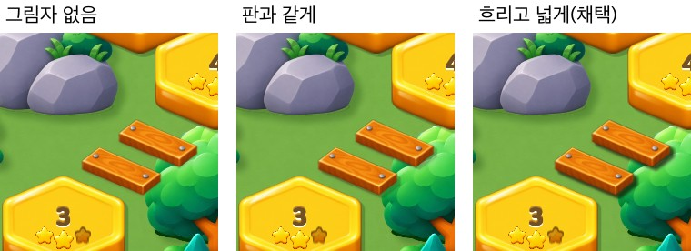

안녕하세요, 이 블로그 주인입니다. 띠모아의 다음 이야기인 **띠모아 HEX**(육각 판 퍼즐)의 스테이지 지도를 이번 주에 새로 만들었습니다. 그림을 몇 번이나 엎었는데, 그 과정에서 정한 규칙을 적어 둡니다. 나중에 띠모아 지도도 같은 방식으로 바꿀 생각이라, 그때 이 글을 다시 볼 겁니다.

다룰 순서는 이렇습니다.

1. 배경
2. 배경 요소(소품)
3. 스테이지(판) 배치
4. 이음새
5. 이음새 시선 처리
6. 그림자

### 1. 배경 — 통그림을 버리고 낱장으로

처음에는 AI 이미지 도구(Codex)에게 지도 한 장을 통째로 그리게 했습니다. 판 자리를 표시한 안내 그림을 주고, 그 둘레에 숲·언덕·물을 그리라고 했습니다. 결과는 이랬습니다.

| 시도 | 결과 |
|---|---|
| 판 자리를 보고 전체를 그림 | 숲이 빽빽해 요소가 너무 많음 |
| 같은 방식에 요소 개수 상한을 숫자로 줌 | 텅 빈 잔디판 |
| 다른 시안 결로 다시 | 길 둘레 절벽이 너무 높음 |
| 들판 시안 결로 다시 | 소품이 작고 가장자리에만 붙음 |
| 평평한 바닥 한 장 + 코드로 소품 | 바닥이 얼룩지거나 밋밋함 |

통그림은 판 배치를 하나만 바꿔도 처음부터 다시 그려야 합니다. 그래서 원칙을 하나로 정했습니다.

> **그림은 낱장으로 그리고, 짜 맞추기는 코드가 한다.**

판 자리에 맞춰야 하는 것은 통그림에 넣지 않습니다. 배치가 바뀌어도 그림을 다시 그릴 필요가 없습니다. 층은 아래에서 위로 이렇게 쌓습니다.

| 층 | 무엇 | 놓는 방법 |
|---|---|---|
| ① 물 바닥 | 하늘색 시냇물 한 장(위아래가 이어짐) | 세로로 반복해 깖 |
| ② 가장자리 땅 | 숲·폭포·넓은 잔디 덩어리 3종 | 왼쪽은 그대로, 오른쪽은 좌우 뒤집어 번갈아 |
| ③ 판 섬 | 잔디 윗면 + 주황 흙 절벽 3종 | 판 바로 밑에 하나씩, 위쪽 섬을 먼저 그려 계단처럼 겹침 |
| ④ 소품 | 나무·버섯·바위·꽃 등 | 땅 윗면 빈 곳에만 |
| ⑤ 판·이음새·팻말 | 이미 있는 그림 | 자리표대로 |

**배치를 먼저 정하고, 배경은 그 뒤에 그립니다.** 배경에 맞춰 판을 옮기기 시작하면 끝없이 어긋납니다. 실제로 이걸 거꾸로 하다가 판과 언덕이 115px씩 어긋난 적이 있습니다.

색은 사람 눈으로 보고 "비슷하다"로 넘기지 않았습니다. 잔디·절벽·나무·물의 평균 색을 숫자로 재서 시안과 색상 ±8, 채도·밝기 ±0.08 안에 들어올 때만 채택했습니다. 안내 그림에서 출발하면 색이 조금씩 떠내려가서 잔디가 노랗고 진해지기 때문입니다.

마을 하나가 섬 하나이고, 섬 사이는 바다입니다. 바다는 지도 전체에 한 장만 깔고, 섬 그림의 위아래 끝 물은 140줄에 걸쳐 서서히 투명하게 만듭니다. 섬 그림에 그린 물과 바다 그림이 겹치면 경계가 찌그러져 보였습니다. 섬 끝에는 바위·폭포·등불 없이 단순한 물가만 둡니다. 끝이 복잡하면 어디서 마을이 끝나는지 읽히지 않습니다.

### 2. 배경 요소 — 판 사이마다 볼거리 한 무리

소품은 아무 데나 흩뿌리지 않고, **판 사이(이음새 옆)에 한 무리씩** 둡니다. 한 무리는 큰 것 + 작은 것 + 낮은 것입니다. 예를 들면 작은 나무 + 노란 꽃 + 작은 돌입니다.

- 발밑이 반드시 땅 위에 있어야 합니다. 물 위에 뜬 나무는 바로 티가 납니다.
- 판·이음새·팻말 둘레는 비웁니다. 4판 옆 꽃이 판에 걸쳐 있어서 50px 옮긴 일도 있습니다.
- 숲만 빽빽한 구간이 길게 이어지지 않게 합니다. 판 2~3개마다 물·공터·소품 같은 볼거리를 하나씩 넣습니다.
- 마을 테마는 재료만 바꿉니다. 단풍 마을은 같은 자리에 단풍나무·도토리 버섯·낙엽 더미가 들어갑니다. 위쪽에 초록 나무가 남아 있던 것도 단풍색으로 다시 칠했습니다.
- 다른 게임과 닮지 않게 나무다리·울타리는 그리지 않습니다. 동물·글씨·탁한 색도 넣지 않습니다.

### 3. 스테이지 — 45° 육각 격자

판 그림은 비스듬히 내려다본, 위가 뾰족한 육각 돌판입니다(300×300). 이 그림에서 이웃 판과 **변이 꼭 맞닿는 방향은 화면 45°와 135°**입니다. 그래서 판 자리는 이 두 방향만 쓰는 격자로 잡았습니다.

- 한 그룹 안 판 사이는 한 칸 **238px**입니다. 판끼리 변이 붙습니다.
- 그룹과 그룹 사이는 꼭 **두 칸 476px**입니다. 판 하나 자리를 비워 두고 그 자리에 이음새를 놓습니다.
- 꺾일 때는 화면에서 90°로 꺾습니다.

이 결론에 닿기까지 해 본 것들입니다.

| 시도 | 결과 |
|---|---|
| 땅 위 직각(37.6°·142.4°)으로 계산 | 판끼리 변이 안 맞고 겹침 |
| 30°·150° | 판을 0.89배로 줄여야 하고 모서리끼리 닿음 |
| 그룹 사이 570px(칸의 정수배 아님) | 직선으로 가다가 중간에 간격이 틀어짐 |

교훈은 하나입니다. **땅 위에서 계산하지 말고, 사람 눈에 보이는 대로 맞춘다.** 판 그림은 이미 원근이 들어간 그림이라, 그 그림이 맞닿는 각도가 곧 정답입니다.

판 "가운데"도 다시 정했습니다. 예전에는 그림 높이의 42% 지점을 가운데로 썼는데, 번호가 새겨진 윗면 가운데보다 26px 위라 길이 어긋나 보였습니다. 지금은 윗면 가운데(번호 자리)가 판의 기준점입니다.

### 4. 이음새 — 돌에서 판자로

처음 이음새는 판 사이에 놓은 이음돌 두 개였습니다. 문제가 계속 났습니다.

- 판 사이가 좁아 돌이 판을 덮었습니다 → 판 간격을 돌 두 개가 들어갈 만큼 벌림
- 대각선에서 두 돌이 붙어 보였습니다 → 돌 사이 62 → 78 → 1.3배

그 뒤 판을 그룹으로 묶는 구조로 바꾸면서, 그룹 사이를 잇는 소품을 여러 가지 그려 봤습니다.

판자·다리·철길·나무 철길·통나무·디딤돌·꽃 디딤돌 일곱 가지입니다. 게임에서 `-link 1~7`로 바꿔 끼우며 비교했고, 실제 지도에 놓아 보며 판자와 침목 두 가지로 좁혔습니다.

이음새도 판처럼 **판 자리에서 바로 계산**합니다. 따로 좌표표를 두지 않으니, 판을 옮기면 이음새가 저절로 따라옵니다.

### 5. 이음새 시선 처리 — 가장 오래 걸린 부분

판자를 놓으니 "떠 보인다"는 문제가 남았습니다. 판자를 길 방향과 화면에서 직각(−45°)으로 돌리면 판의 시점과 달라 공중에 뜬 것처럼 보였고, 땅 위 직각(−31°)으로 계산해 돌리면 판자의 옆면·나사·그림자까지 같이 기울어 어색했습니다. 판자 그림을 기울여(전단) 평행사변형으로 만들면 옆면이 찌그러졌습니다.

결국 각도를 계산하는 대신 **판 그림의 꼭짓점에서 선 두 개를 긋고, 그 사이를 판자 통로로 삼았습니다.**

**꼭짓점 번호.** 윗면 맨 위(번호 위 정중앙)가 1번이고, 시계 방향으로 2 오른쪽 위, 3 오른쪽 아래, 4 맨 아래, 5 왼쪽 아래, 6 왼쪽 위입니다. 판 옆면 두께는 그림에서 40px이고, "○번 아래"는 그 꼭짓점에서 40px 곧게 내려온 곳, 곧 판이 땅에 닿는 곳입니다.

**시선 선 두 개.** ↗ 방향 길(아래 판 → 위 판)은 이렇습니다.

- 노란 선: 아래 판 **1번** → 위 판 **5번 아래**
- 주황 선: 아래 판 **2번** → 위 판 **4번 아래**

두 선은 약 37°로 거의 나란하고, 그 사이가 판자가 깔리는 통로입니다. ↖ 방향은 좌우를 뒤집어 1번 → 3번 아래, 6번 → 4번 아래입니다.

위 판 쪽을 "윗면"이 아니라 **"아래"(옆면 바닥)**로 잡은 것이 핵심입니다. 처음엔 두 판 모두 윗면 꼭짓점끼리 이었는데, 판자는 판 위가 아니라 땅 위에 놓이니 위 판 쪽은 땅에 닿는 높이가 맞았습니다.

판자는 통로의 **20~40%, 60~80%** 자리에 두 장 놓아 앞뒤 틈이 같게 합니다.

**판자 그림은 돌리지 않습니다.** 대신 처음부터 통로 모양으로 그렸습니다. 똑바른 판자의 양 끝을 60°로 자르고, **윗면만 22.6° 돌려** 그린 그림입니다(22.6°는 판 윗면 오른쪽 위 변의 기울기입니다). **옆면(두께)은 언제나 화면 아래로 곧게** 그렸습니다. 놓을 때는 윗면 긴 변이 통로 폭과 같도록 크기만 맞추고, 윗면 가운데를 통로 자리 가운데에 맞춥니다. ↖ 방향은 좌우 뒤집기만 합니다.

정리하면 이 그림체에서는 **"물체를 돌리는" 것이 아니라 "윗면만 돌리고 옆면은 늘 아래로"**가 맞았습니다. 내려다보는 그림에서 두께는 항상 화면 아래로 떨어지기 때문입니다.

### 6. 그림자 — 빛은 왼쪽 위 하나

지도에 놓이는 모든 것은 빛이 **왼쪽 위**에서 온다고 보고, 그림자를 **오른쪽 아래**로 떨어뜨립니다. 판·이음돌·팻말·소품·판자가 모두 같은 쪽입니다. 하나만 다른 방향이면 바로 어색합니다.

그림자는 따로 그리지 않고 **같은 그림을 어둡게 칠해 비켜 찍습니다.** 색은 검정이 아니라 잔디에 어울리는 진한 초록빛(RGB .05 · .14 · .02)입니다.

| 대상 | 비켜 찍기 | 진하기 |
|---|---|---|
| 판 | 오른쪽 아래 8 · 7 | 22% |
| 이음돌 | 8 · 6 | 45% |
| 팻말 | 15 · 9 | 30% |
| 판자 | 8 · 7을 3px씩 3×3번 겹쳐 찍음 | 12% |

판 그림자는 처음에 "입체감이 없다"는 말에 넣었고, 두 겹(넓고 옅게 + 좁고 진하게) → 한 겹 11·9 → 8·7로 세 번 줄였습니다. 그림자는 진해질수록 판이 땅에서 뜬 것처럼 보였습니다.

판자 그림자는 네 가지(없음·판과 같게·진하게·흐리고 넓게)를 `-plankshadow 0~3`으로 만들어 나란히 보고 **흐리고 넓게**를 골랐습니다. 판자는 얇아서 판과 같은 그림자를 주면 판처럼 두꺼워 보이고, 없으면 잔디 위에 붙은 스티커처럼 보입니다. 같은 그림을 3px씩 아홉 번 옅게 겹쳐 찍으면 가장자리가 흐려져 낮게 깔린 느낌이 납니다.

소품 그림자는 **잔디 위에만** 떨어지게 했습니다. 물이나 절벽 위로 그림자가 넘어가면 높이가 맞지 않아 보입니다.

### 정리

| 주제 | 한 줄 규칙 |
|---|---|
| 배경 | 낱장으로 그리고 코드가 짜 맞춘다. 배치가 먼저, 배경은 나중 |
| 배경 요소 | 판 사이마다 큰 것 + 작은 것 + 낮은 것 한 무리, 발밑은 땅 위 |
| 스테이지 | 판 그림이 맞닿는 45°·135° 격자, 한 칸 238 · 그룹 사이 두 칸 476 |
| 이음새 | 따로 좌표를 두지 않고 판 자리에서 계산 |
| 시선 처리 | 아래 판 윗면 꼭짓점 → 위 판 옆면 바닥, 윗면만 돌리고 옆면은 늘 아래로 |
| 그림자 | 빛은 왼쪽 위 하나, 같은 그림을 초록빛으로 오른쪽 아래에 옅게 |

이번에 가장 크게 배운 것은 **원근이 들어간 그림에서는 수학보다 그림을 믿어야 한다**는 것입니다. 땅 위 각도를 계산해서 맞춘 것은 전부 어긋났고, 판 그림의 꼭짓점을 직접 재서 이은 것만 맞았습니다. 다음에는 같은 규칙으로 띠모아 지도를 바꿔 보겠습니다.
